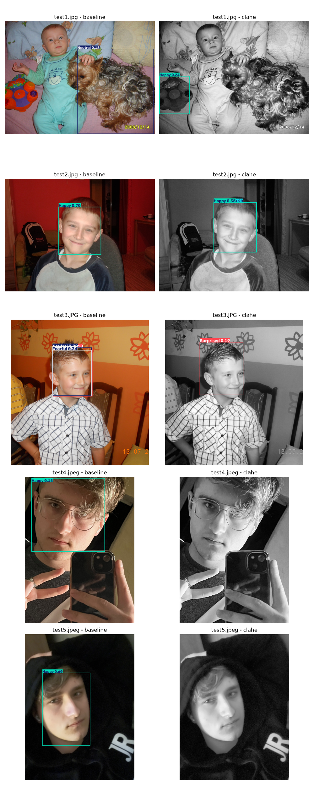

# Zadanie 3 – Detekcja twarzy i ocena emocji (YOLOv8)

Projekt z przedmiotu Grafika komputerowa i przetwarzanie obrazów.
Jeden model YOLOv8n wykrywa twarz i zwraca emocję jako klasę (fine-tuning
na otwartym zbiorze danych, trening na CPU w GitHub Codespaces).

## Uruchomienie
1. `python3 -m venv .venv && source .venv/bin/activate && pip install -r requirements.txt`
2. Notebook `image-detection.ipynb`: komórki po kolei (pobranie zbioru wymaga darmowego klucza API Roboflow).
3. Trening: `python train.py`. Ewaluacja i predykcja używają wag z `results/*/best.pt`.

## Zbiór danych
- Źródło: [Emotion Detection](https://universe.roboflow.com/jhazmine-therese-roque-biwst/emotion-detection-ooj7h), wersja 4
- Autor: Jhazmine Therese Roque, licencja CC BY 4.0
- Podział: 4483 train / 550 valid / 566 test
- 7 klas: Angry, Disgusted, Fearful, Happy, Neutral, Sad, Surprised
- Klasy wyrównane (ok. 640 ramek na klasę w train)
- Zdjęcia małe, ok. 88% w skali szarości (próbka 200 zdjęć), ramka zajmuje
  średnio 90% obrazu (mediana 100%) – większość to twarze przycięte do kadru

## Preprocessing
Skala szarości → rozmycie Gaussa 3x3 → CLAHE (clipLimit 1,5, siatka 2x2).
Przy małych zdjęciach standardowa siatka 8x8
wzmacniała artefakty kompresji.

## Trening
- YOLOv8n (wagi COCO), fine-tuning na CPU, imgsz 96, seed 42
- Maksymalnie 50 epok, wczesne zatrzymanie (`patience=15`)
- Dwa treningi z identycznymi parametrami: `baseline` (oryginalne zdjęcia)
  i `clahe` (zdjęcia po preprocessingu), skrypt: `train.py`
- Pliki z przebiegu (CSV, wykresy, macierze pomyłek, wagi): `results/`

## Wyniki (zbiór testowy, 566 zdjęć)

| model    | mAP50 | mAP50-95 | precision | recall |
|----------|-------|----------|-----------|--------|
| baseline | 0,615 | 0,590    | 0,472     | 0,726  |
| clahe    | 0,600 | 0,578    | 0,477     | 0,696  |

Różnica między modelami (ok. 1,5 p.p. mAP50) jest w granicach szumu: to jeden
przebieg treningu na model, więc można tylko stwierdzić, że CLAHE nie poprawił wyniku.
Hipoteza: zdjęcia są małe, skompresowane i w większości szare, więc rozmycie i CLAHE 
mogły wzmacniać artefakty i zabierać szczegóły mimiki zamiast poprawiać kontrast.

Wyniki baseline'u na klasach (mAP50): Happy 0,83, Surprised 0,81, Disgusted 0,80,
Neutral 0,62, Angry 0,42, Fearful 0,42, Sad 0,40. Macierze pomyłek:
`results/baseline/confusion_matrix_test.png`, `results/clahe/confusion_matrix_test.png`.

Dodatkowo sprawdziłem, co się stanie, gdy preprocessing nie pasuje do treningu
(mAP50 na zbiorze testowym):

| model \ zdjęcia testowe | oryginalne | po CLAHE |
|-------------------------|-----------|----------|
| baseline                | 0,615     | 0,578    |
| clahe                   | 0,538     | 0,600    |

Każdy model działa najlepiej na takich danych, na jakich się uczył, a rozjazd kosztuje
ok. 4-6 p.p. Stosowanie CLAHE tylko przy predykcji (na modelu baseline) nie poprawia
wyniku, tylko go pogarsza. Jeden przebieg na każdy model, więc to wynik, a nie reguła.

Test na identyczne pliki w train i test: 0 wspólnych zdjęć (sprawdzone tylko
dokładne duplikaty, nie podobne zdjęcia).

## Własne zdjęcia

Na kilku własnych zdjęciach z tłem (`samples/`) model działa wyraźnie gorzej niż
na zbiorze testowym:

- baseline znalazł twarz na 4 z 5 zdjęć, clahe na 2 z 5,
- pewność emocji jest niska (najczęściej 0,15-0,35), a na jednej twarzy bywają
  dwie nakładające się klasy,
- na zdjęciu niemowlęcia żaden model nie znalazł twarzy, za to oba narysowały ramkę
  na tle (pies, zabawka). Ramki na psie i zabawce to fałszywe detekcje o niskiej pewności 
  (0,18 i 0,24), widoczne dzięki obniżonemu progowi. Brak wykrycia twarzy niemowlęcia 
  może wynikać z tego, że w obejrzanych przeze mnie próbkach zbioru były głównie dorośli 
  ludzie (hipoteza; nie sprawdzono całego otwartego zbioru ze względu na objętość ponad 
  5tys. zdjęć).
- wykres narysowano z obniżonym progiem pewności (`conf=0,15` zamiast domyślnego 0,25),
  bo przy 0,25 większość ramek znikała. Niższy próg pokazuje, że model *znajduje* twarz,
  ale nie zwiększa pewności emocji,
- wynik zależy od rozmiaru wejścia (`imgsz`), CLAHE mocniej: na jednym zdjęciu
  ta sama klasa dostała pewność 0,35 / 0,84 / 0,65 dla 96 / 160 / 320 px.

## Ograniczenia
- Zbiór to głównie małe, przycięte, szare twarze, a zbiór testowy pochodzi
  z tego samego rozkładu. Metryki testowe pokazują więc jakość na danych podobnych do
  treningowych, a nie na zdjęciach z kamery.
- CLAHE nie poprawił wyniku. Przypuszczalnie dlatego, że zbiór jest już w większości
  dobrze naświetlony, a rozmycie zabiera szczegóły mimiki. Nie sprawdzałem tego
  osobnym treningiem (np. samo CLAHE bez rozmycia).
- Przy predykcji preprocessing liczony jest na pełnym zdjęciu, a przy treningu na
  małych obrazkach, więc w innej skali. To też tylko hipoteza.
- Pięć własnych zdjęć to anegdota, nie statystyka.
- Rozpoznawanie emocji z samej twarzy jest zawodne, a zbiór zawiera głównie wyraziste
  miny. 
  
## Wnioski
Sama funkcja wykrywania twarzy jest ciekawą funkcją, która przy zbalansowanej i szerokiej
bazie danych mogłaby działać znakomicie, oraz znaleźć zastosowanie w bardziej praktycznym
celu niż jako eksperyment. Cały projekt jednak opiera się na jednym modelu, którego zadaniem jest 
zarówno detekcja twarzy jak i ocena emocji – ze względu na drugi aspekt ocena emocji powinna 
być zdecydowanie traktowana jako eksperyment, z racji, że wykrywanie prawdziwych emocji u człowieka 
na podstawie zdjęcia jest raczej skomplikowanym procesem. Owszem, można robić jakieś założenia na podstawie 
mimiki twarzy, lecz na to nakłada się również celowe ukrywanie emocji oraz różnice 
w sposobie ich okazywania.

## Licencja
Wszelkie prawa do własnych zdjęć w folderze `samples/` (test1-test5) oraz do ich
użycia w `results/prediction_examples.png` są zastrzeżone przez autora repozytorium.
Nie mogą być wykorzystywane, kopiowane, modyfikowane ani rozpowszechniane bez
jego pisemnej zgody. Zastrzeżenie dotyczy wyłącznie tych zdjęć.

Model bazuje na YOLOv8 (Ultralytics, AGPL-3.0).

Zbiór danych: [Emotion Detection](https://universe.roboflow.com/jhazmine-therese-roque-biwst/emotion-detection-ooj7h),
wersja 4, autor Jhazmine Therese Roque, licencja CC BY 4.0. Zbiór nie jest częścią
repozytorium; w projekcie został przetworzony (skala szarości, rozmycie, CLAHE).