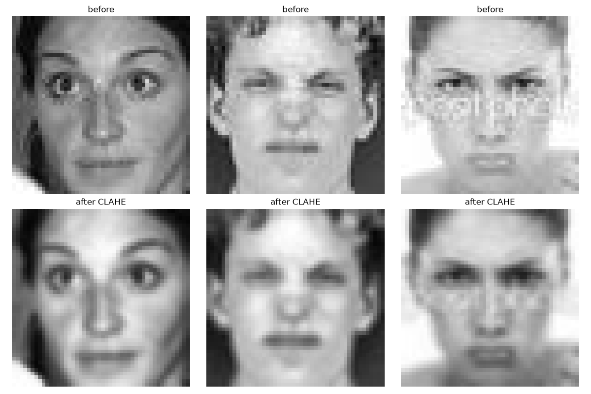

# Detekcja twarzy i ocena emocji (YOLOv8)

Projekt z przedmiotu Grafika komputerowa i przetwarzanie obrazów.
Jeden model YOLOv8n wykrywa twarz i zwraca emocję jako klasę (fine-tuning
na otwartym zbiorze danych, trening na CPU w GitHub Codespaces).

## Zbiór danych
- Źródło: [Emotion Detection](https://universe.roboflow.com/jhazmine-therese-roque-biwst/emotion-detection-ooj7h), wersja 4
- Autor: Jhazmine Therese Roque, licencja CC BY 4.0
- Podział: 4483 train / 550 valid / 566 test
- 7 klas: Angry, Disgusted, Fearful, Happy, Neutral, Sad, Surprised
- Klasy wyrównane (ok. 640 ramek na klasę w train)
- Zdjęcia małe, ok. 88% w skali szarości (próbka 200 zdjęć), ramka zajmuje
  średnio 90% obrazu (mediana 100%) – większość to twarze przycięte do kadru

## Preprocessing
Skala szarości → rozmycie Gaussa 3x3 → CLAHE (clipLimit 1,5, siatka 2x2).
Przy małych zdjęciach standardowa siatka 8x8
wzmacniała artefakty kompresji.

## Trening
- YOLOv8n (wagi COCO), 10 epok, imgsz 96, CPU
- Dwa treningi: `baseline` (oryginał) i `clahe` (po preprocessingu)